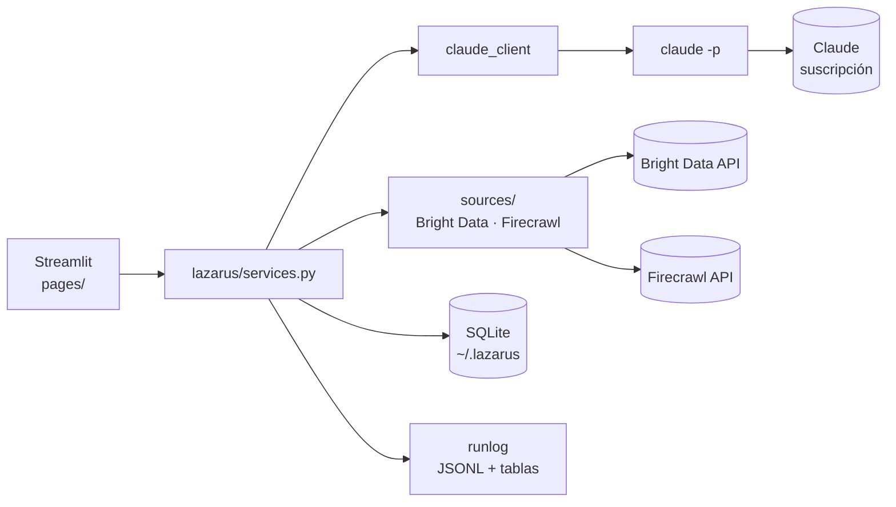

# Lazarus

Aplicación local para buscar empleo con IA. Proyecto del programa **AWS re/Start**.

> "Lazarus" es un nombre provisional.

Lazarus busca vacantes en varios portales, las compara con el CV del usuario, escribe cartas de presentación
y muestra qué piden las empresas. Todo corre en la computadora del usuario. La IA es **Claude**, mediante
`claude -p` y la suscripción local de Claude Code.

**Lazarus nunca aplica a una vacante.** El usuario aplica en el portal original.

## Funciones (MVP)

| Función | Descripción |
|---|---|
| CV | Carga un CV en PDF o DOCX. Claude extrae skills, seniority, idiomas y roles. |
| Búsqueda | Bright Data (LinkedIn Jobs, Indeed, Glassdoor) y Firecrawl (lista configurable de portales: Computrabajo, OCC, Bumeran, Get on Board…). Sin duplicados. |
| Ranking | Claude analiza cada vacante. Python calcula un score de 0 a 100. Claude explica las 10 mejores. |
| Carta | Claude escribe una carta con hechos del CV. El usuario la edita y la descarga en DOCX. |
| Mercado | Top skills, brecha CV vs mercado, seniority, modalidad y salarios publicados. |
| Actividad y diagnóstico | Cada acción tiene un `run_id`. Logs con pasos, tiempos, consumo y errores. Vista de rendimiento. |
| Configuración | Claves de API cifradas (DPAPI en Windows), datasets de Bright Data, dominios, sesión de Claude. |

## Arquitectura



Decisiones principales:

- **Score determinista en Python.** Rápido, repetible y fácil de probar. Claude solo escribe las razones.
- **Claude sin herramientas** y en una carpeta temporal vacía. El texto de las vacantes es contenido externo.
- **El CV solo sale hacia Claude.** Bright Data y Firecrawl solo reciben rol, ubicación y dominios.
- **Datos fuera del repositorio** (`~/.lazarus`): base SQLite, logs y claves cifradas.

## Instalar en Windows

1. Descargue `Lazarus-Setup-<versión>.exe` (ver *Releases*) y ejecútelo. No necesita permisos de administrador.
   SmartScreen puede advertir que no está firmado: **Más información → Ejecutar de todas formas**.
2. Abra **Lazarus** desde el menú Inicio. El navegador abre la app.
3. Si no hay sesión de Claude, use el botón **Iniciar sesión en Claude**.
4. En **Configuración**, pegue las claves de Firecrawl y Bright Data.

Requisito aparte: [Claude Code](https://claude.com/download) 2.1.41 o superior.

## Desarrollo

```bash
python -m venv .venv
source .venv/bin/activate          # Windows: .venv\Scripts\activate
pip install -r requirements.txt
streamlit run app.py               # http://localhost:8501
pytest -q                          # sin red y sin claude (usa fakes)
```

Las claves se cargan en **Configuración**. Para desarrollo también se pueden poner en `.env` (ver `.env.example`).
Nunca suba `.env`, bases de datos, logs ni CV reales.

### Construir el instalador

Desde Linux, con `nsis`, `zip`, `curl` y `python3`:

```bash
installer/build.sh
```

El script descarga Python 3.12 para Windows (python-build-standalone), instala las librerías `win_amd64`,
comprime la app y genera `dist/Lazarus-Setup-<versión>.exe`.

## Estructura

```
app.py, pages/            UI de Streamlit (sin lógica de negocio)
launcher.py               lanzador de Windows (una instancia, solo 127.0.0.1)
lazarus/services.py       casos de uso que llama la UI
lazarus/claude_client.py  única puerta a claude -p (prompts/ y schemas/)
lazarus/sources/          Bright Data y Firecrawl
lazarus/normalize.py      URLs, skills canónicas y duplicados
lazarus/scoring.py        score determinista
lazarus/metrics.py        métricas de mercado
lazarus/runlog.py         logs de corridas y pasos
lazarus/secrets.py        claves cifradas (DPAPI)
data/domains_base.toml    lista base de portales
installer/                NSIS, script de build e ícono
tests/                    pytest
```

## Troubleshooting

1. Copie el `run_id` del mensaje de error.
2. Abra **Actividad y diagnóstico** y busque la corrida. Lea el paso con estado `error`.
3. Si la causa no está clara, active el **modo debug** en Configuración y repita la acción.
4. Exporte la corrida (ZIP) si necesita ayuda.

ADVERTENCIA: el modo debug guarda el texto del CV en `~/.lazarus/logs/debug/`. Desactívelo al terminar.

## Hoja de ruta

| Fase | Función |
|---|---|
| 2 | Mejoras al CV |
| 3 | Tracker de vacantes |
| 4 | Preparación de entrevista |
| 5 | Sincronización del perfil de LinkedIn |

## Estado

MVP en pruebas. Pendientes: `dataset_id` de Indeed y Glassdoor, y validar el mapeo de campos de Bright Data
con respuestas reales.
